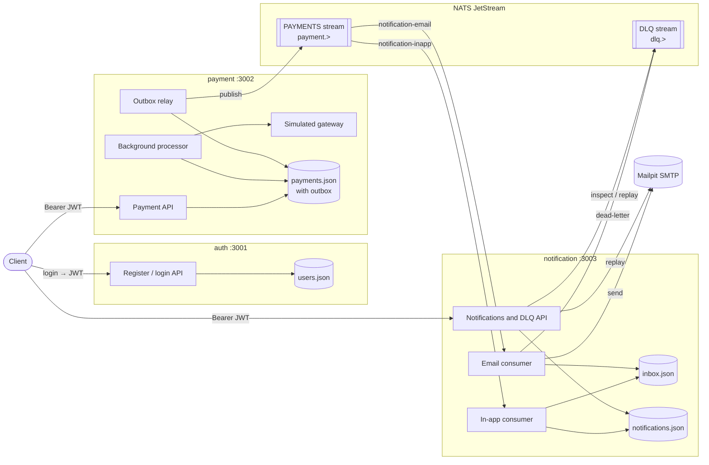
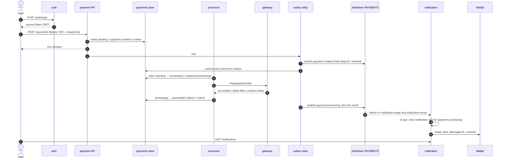
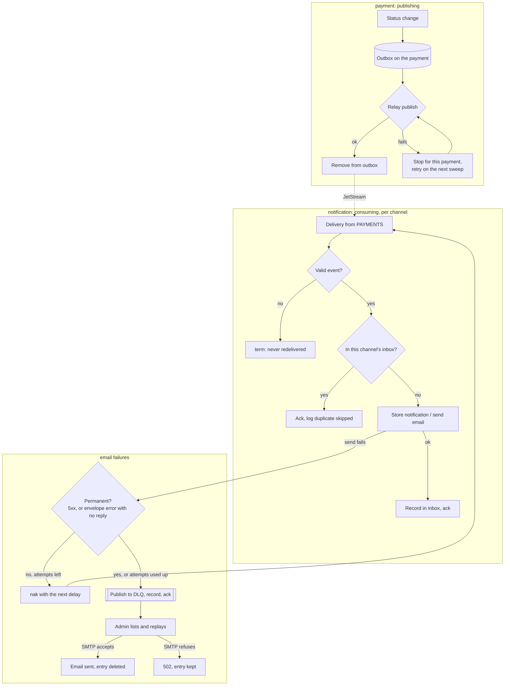

# Architecture

How the payment simulation is put together: the services and what each one owns, how a payment moves through them, and what happens when something fails. The [README](../README.md) has setup, the API reference and the event catalogue; this document explains the design behind them.

## Services and boundaries

| Service | Owns | Talks to |
|---|---|---|
| `auth` | Users and their bcrypt password hashes; issues HS256 JWTs with `sub`, `email` and `role` | Nothing at runtime |
| `payment` | Payments, their status rules and the outbox of events not yet published | NATS (publishes to `PAYMENTS`) |
| `notification` | In-app notifications and, per channel, which events it has already handled (the inbox) | NATS (consumes `PAYMENTS`, publishes to and reads `DLQ`), SMTP |
| `libs/shared` | No data. Config loading, event contracts, the NATS wrapper, logger, error model, response envelope, repository adapters and auth middleware | — |

The rules that keep the boundaries real:

- **No shared code between services, and no shared storage.** Each service reads and writes only its own repository (in memory or a JSON file). Anything two services need, such as an event schema, lives in `libs/shared`.
- **Events are the only runtime link.** `payment` never calls `notification`, and nobody calls `auth` after login: `payment` and `notification` verify the JWT themselves with the shared secret.
- **Events carry what consumers need.** Every payment event includes the owner's `userId` and email, so `notification` never has to look a user up.
- **Money is an integer in minor units with an ISO 4217 code**, everywhere, including events.

## How a payment moves through the system

- A status change and its event are written together in one compare-and-set update, so neither can exist without the other. The relay publishes afterwards.
- The correlation ID of the `POST /payments` request is stored with each outbox entry and sent in the `x-correlation-id` header, so one ID can be followed from the HTTP request through the processor to both notification channels.
- An admin can cancel a `pending` payment, or settle a `processing` one, with `PATCH /payments/:id/status`. That change goes through the same compare-and-set update as the processor's, so whichever is saved first wins and the other gets a conflict.

The event types and their payload are listed in the README under [Events](../README.md#events).

## Failure handling

### Publishing: the outbox

`payment` never publishes inside a request. Each event is saved in the payment record's outbox in the same write as the status change, and the relay publishes it right after, on a timer, and once at startup. If NATS is down, the status change still succeeds and the event waits. One payment's events go out in order: the relay stops at that payment's first failed publish and tries again on the next sweep. Delivery is at least once. If `payment` stops between publishing and removing an event, it is published again with the same `eventId`; JetStream drops the repeat within its 2-minute duplicate window, and consumers ignore it after that. Detail: [BE-04-02](../tasks/BE-04-02-payment-event-outbox.md).

### Consuming: at-least-once delivery and the inbox

`notification` has two durable pull consumers on `PAYMENTS`, one per channel, each with explicit acks. JetStream may deliver a message more than once (a redelivery after a missed ack, a consumer recreated from the start, a late outbox republish), so each channel keeps an inbox keyed by `eventId` + channel. An event is recorded only after its work succeeds, and skipped on any later delivery. Keying by channel means an email retry is never hidden by the in-app notification having been stored already. A message that is not valid JSON or fails the schema is terminated, so it never loops. In-app notifications also use the `eventId` as their ID, so handling an event twice after a crash still leaves one notification. Detail: [BE-05-02](../tasks/BE-05-02-idempotent-event-handling.md).

### Email retries and the dead-letter queue

JetStream has no built-in dead-letter stream, so the email handler runs its own. A failed send is nak'd with a delay from `EMAIL_RETRY_DELAYS_MS`, up to `EMAIL_MAX_ATTEMPTS` deliveries. A permanent rejection (a 5xx reply, or an envelope error with no reply) is not retried. When attempts run out, or on a permanent rejection, the handler publishes the event to the `DLQ` stream with the reason (`exhausted` or `rejected`) and the last SMTP error, records the event as handled and acks it, so JetStream stops redelivering. Admins list, read and replay entries through `/admin/dlq`. A replay sends the email inside the request and deletes the entry only if the send succeeds. The in-app channel has no limit: it retries every 5 seconds until storing works. Detail: [BE-05-05](../tasks/BE-05-05-email-retries-dlq.md).

### Concurrent updates

Every repository update is compare-and-set on a `version` field. The processor and an admin `PATCH` can race for the same payment; the loser re-reads, re-checks the transition and either retries (up to 3 times) or gets `409`. The JSON-file adapter writes through a temporary file and a rename, with one writer per file, so a crash never leaves a half-written file. Detail: [BE-01-07](../tasks/BE-01-07-repository-interface.md), [BE-01-08](../tasks/BE-01-08-json-file-adapter.md).

### Readiness and graceful shutdown

`/health/ready` checks each service's real dependencies: storage for all three, the NATS connection for `payment` and `notification`, and the consumer loops for `notification`. It returns `503` while any of them fails, for example during a NATS outage. On SIGTERM or SIGINT a service stops accepting connections, lets in-flight requests finish, then stops in order: the processor and the outbox relay (`payment`), the consumers (`notification`), the NATS connection (drained, then force-closed if the drain fails), and storage. A 10-second timer force-exits if shutdown hangs. Payments left `processing` by a shutdown are resumed on the next start. Detail: [BE-01-04](../tasks/BE-01-04-service-skeleton.md), [BE-03-05](../tasks/BE-03-05-payment-processor.md).
